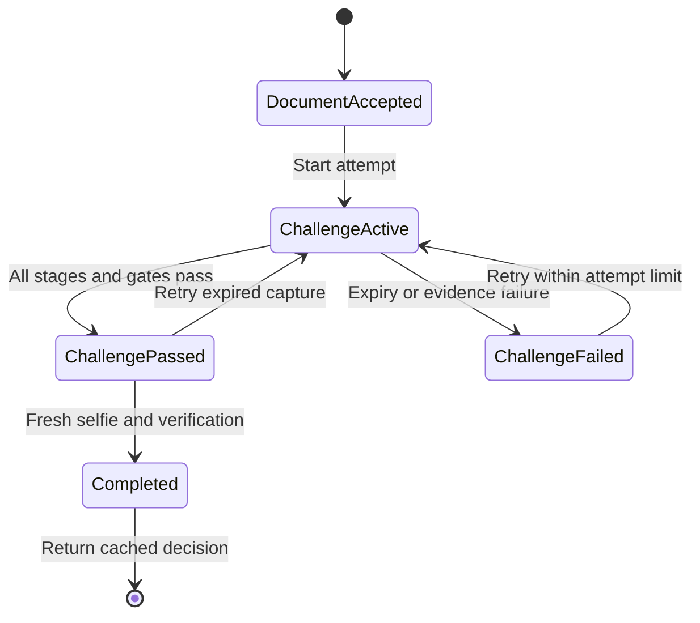

# Architecture and boundaries

## Components

| Layer | Responsibility |
|---|---|
| React components | File selection, consent, preview, camera lifecycle, ordered frame submission, results |
| `api/routes.py` | Typed HTTP contracts, bearer extraction, service invocation |
| `core/middleware.py` | JSON logs, request IDs, request byte limits, bounded in-flight bodies |
| `core/config.py` | Validated environment settings and model-mode startup requirements |
| `services/kyc_service.py` | Orchestrates session ownership, evidence, model gates and final result |
| `services/session_store.py` | Expiry, hashed bearer credentials, per-session locks, revocation |
| `services/decision.py` | Explicit decision policy, thresholds and review reasons |
| `vision/document_processor.py` | Contours, corner ordering, perspective warp, orientation, type inference, face crop |
| `vision/face_verifier.py` | Haar detector, optional eye-line correction, embeddings and distance metrics |
| `vision/liveness.py` | MediaPipe landmarks, EAR, pose ratio, PAD, temporal challenge state |
| `vision/model_loader.py` | Local TorchScript load and deterministic preprocessing contracts |
| `vision/image_io.py` | Base64/file decoding, EXIF correction, actual format and pixel limits |

## State progression

Session expiry and explicit deletion can remove any state. The browser cannot
send a trusted `passed` flag or a similarity score. The final API accepts only the
session IDs and fresh selfie; evidence comes from server state.

## Concurrency and resource limits

- HTTP body limit is enforced before parsing, including chunked bodies. Actual
  decoded image bytes and pixels are checked separately before conversion.
- At most eight requests enter the bounded middleware concurrently. Excess load
  returns 503. Nginx additionally rate-limits uploads and frame requests.
- CPU inference runs in FastAPI's sync route threadpool. Model access is locked.
- Each session has a lock around attempts, ordered frames and final consumption.
- There are at most 100 retained sessions by default, expiring after 10 minutes;
  a background task prunes expired sessions every 30 seconds. Authorization also
  rejects an expired session immediately.
- Each challenge expires after 90 seconds and accepts at most 900 unique frames.
  The final capture window is 20 seconds. Maximum attempts per session: 3.
- Restarting the process loses sessions. Multiple workers have independent
  stores and are unsupported until the store is replaced.

## Evidence and limitations

Document boundary detection is a contour heuristic. A plain photograph, screen
or forged document can still resemble a document; classification is not an
authenticity test. Haar may miss tilted faces, dark portraits, or faces under
glare. If Haar detects multiple candidates, the largest is shown in the upload
preview, a warning is returned, and the final decision requires manual review.
This also covers text or holograms falsely detected as faces. A reviewer must
confirm that the selected crop is the correct identity portrait. The selected
document type is never used as a verified prediction.

EAR measures the ratio of eyelid distances to eye width. MediaPipe's six points
per eye are converted to pixel coordinates before calculating EAR. Blink
detection requires open observations, a short closure, and reopening. A frame gap
over 1.5 seconds resets partial evidence. The yaw value is a dimensionless
nose/eye-position proxy, not a calibrated head angle or a 3-D pose estimate.

LBP entropy, sharpness and brightness are diagnostics, not learned spoof
probabilities. Learned PAD uses its own explicit model and threshold. The default
demo deliberately does not call texture entropy “live probability”.

Session binding, order, duplicate fingerprints, randomized challenges and
embedding continuity prevent common integration mistakes. They do **not** attest
that arbitrary HTTP frame inputs came from a physical camera. A compromised
client, virtual camera, adaptive replay or generated video may bypass simple
RGB challenge checks. Validate attacks on the actual deployment; add stronger
capture/PAD controls where the use case requires them.

Face matching is limited to comparing the document and presented selfie for the
consenting session. There is no identity search database. A match does not
establish a person's legal identity, nationality, or any demographic attribute.

## Retention and authentication

The API does not write image files. It retains document embeddings and at most
one small challenge face/observation per session; successful completion releases
biometric arrays. Python object release is not guaranteed physical memory
zeroization. Browser previews remain in component memory until restart, reload,
or tab closure. A completed result remains in server memory until deletion or TTL.

Opaque bearer tokens are hashed in the server store and held only in React
memory. They grant access only to the matching session. This is session ownership,
not customer account authentication. Integrate with your application's logged-in
customer and issue quotas before public deployment. No frontend API key is used.

To scale, replace the store with Redis or another shared service supporting
atomic per-session state transitions, TTL, bounded evidence, and one-use final
results. If you add persistent evidence storage, define retention, encryption,
access and audit behavior explicitly; none is silently enabled in this sample.
